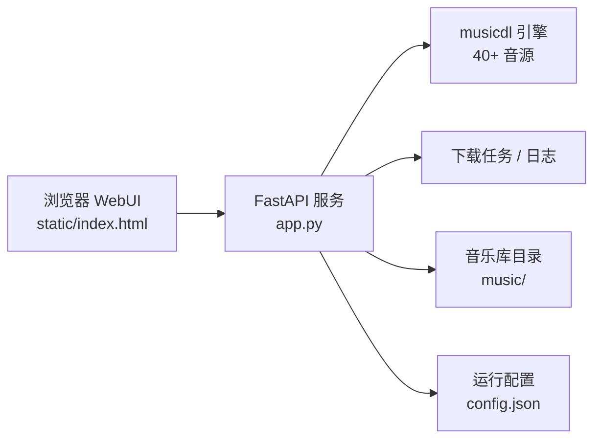

# musicdl WebUI

一个面向个人音乐库的本地 WebUI：用浏览器搜索、试听、解析歌单并下载音乐，底层由 [musicdl](https://github.com/CharlesPikachu/musicdl) 提供音源能力，后端使用 FastAPI，支持 Windows、Linux、macOS，以及 Docker / NAS 部署。

> 本项目是 musicdl 的 Web 封装与增强界面，不是 musicdl 引擎本身。音源的可用性取决于上游平台和 musicdl 的实现。

## 功能一览

- **40+ 音源**：按华语平台、国际流媒体、电台 / 有声、聚合网关、下载站等分类选择。
- **搜索与试听**：多音源并发搜索、渐进式展示结果；通过后端流式代理播放，支持 Range 请求。
- **歌单解析**：粘贴受支持平台的歌单链接，批量加入播放列表或下载队列。
- **后台下载**：支持批量下载、分组任务、实时进度、失败重试、运行日志和已下载文件管理。
- **媒体信息完善**：按音源能力写入标签、封面和歌词；歌词可保存为 `.lrc`、嵌入音频，或两者同时保存。
- **音质与来源选择**：结果行显示可用格式与大小，按需选择来源和版本；实际音质取决于音源与账号权限。
- **配置中心**：音源开关、Cookie、代理、超时、重试、并发、分页、浏览器指纹、UA、下载目录和目录分类均可在网页中调整。
- **音乐库友好**：支持按音源、歌手、歌手 / 专辑或平铺方式保存，下载目录可以直接挂载给 Navidrome / Jellyfin。
- **跨平台部署**：提供 Windows / Linux / macOS 启动脚本、Docker Compose 和多架构镜像发布流程。
- **安全边界**：非回环监听默认要求登录，支持 Trusted Host、Secure / HttpOnly 会话 Cookie，以及固定文件根目录校验。

## 工作方式



## 快速开始

### 本地运行

环境要求：

- Python 3.11–3.13
- Git
- Docker 部署不需要在宿主机安装 Python；镜像已包含 FFmpeg

```bash
git clone https://github.com/Agonie0v0/musicdl.git
cd musicdl
```

Windows：

```bat
start.bat
```

Linux / macOS：

```bash
chmod +x start.sh
./start.sh
```

启动脚本会自动创建虚拟环境并安装依赖，然后打开：

<http://127.0.0.1:8765>

Windows 启动脚本会按 3.13、3.12、3.11 的顺序寻找 Python Launcher。Linux / macOS 请确保 `python3` 可用。

如果只想在启动时自动升级 musicdl 引擎：

```bash
MUSICDL_AUTO_UPDATE=1 ./start.sh
```

Windows PowerShell：

```powershell
$env:MUSICDL_AUTO_UPDATE = "1"
.\start.bat
```

### Docker / NAS 部署

默认 Compose 会在本地构建镜像，并把 `./music` 作为下载目录、`./data` 作为配置目录。

```bash
git clone https://github.com/Agonie0v0/musicdl.git
cd musicdl

mkdir -p music data
cp .env.example .env
# 编辑 .env，至少修改 MUSICDL_PASS

docker compose up -d --build
docker compose ps
docker compose logs -f
```

首次启动后访问 <http://127.0.0.1:8765>。Linux / NAS 如果出现写入权限问题，执行：

```bash
chown -R 10001:10001 music data
```

容器使用 UID / GID `10001:10001` 运行，不建议使用 `777` 解决权限问题。

#### 反向代理与 HTTPS

服务器部署建议让 Caddy、Nginx、Lucky 等反向代理负责 HTTPS，回源到 `127.0.0.1:8765`，并把外部域名加入 `MUSICDL_TRUSTED_HOSTS`。

`MUSICDL_COOKIE_SECURE=1` 时，会话 Cookie 只通过 HTTPS 发送；如果只是本机临时使用 HTTP，可以在 `.env` 中暂时设置为 `0`。不要把未经过 HTTPS 保护的 8765 端口直接暴露到公网。

#### 接入 Navidrome / Jellyfin

关键是让 WebUI 的 `/music` 与媒体服务器的音乐目录指向同一个宿主机目录。Compose 中已经附带了注释掉的 Navidrome 服务示例，取消注释即可一起启动：

```yaml
navidrome:
  image: deluan/navidrome:latest
  ports:
    - "4533:4533"
  volumes:
    - ./music:/music:ro
    - ./navidrome-data:/data
  environment:
    - ND_SCANSCHEDULE=1m
```

然后在设置中将“下载分类方式”选择为“歌手 / 专辑”，文件会按照以下形式保存：

```text
music/
└── 歌手/
    └── 专辑/
        └── 歌名.ext
```

## 设置说明

点击页面右上角的设置按钮即可配置。所有配置默认保存到项目目录的 `config.json`；Docker 中建议使用 `/data/config.json` 持久化。

| 设置项 | 作用 |
| --- | --- |
| 音源选择 | 选择参与搜索的音源；“默认五源”为咪咕、网易云、QQ、酷我、千千 |
| Cookie | 每个音源单独粘贴浏览器请求头中的完整 Cookie，程序会自动解析并用于搜索、解析和下载 |
| 基础参数 | 每源结果数、分页大小、重试次数、请求超时、默认线程数 |
| HTTP 代理 | 为全部音源，或仅指定音源设置代理 |
| 下载分类方式 | 按音源、按歌手、歌手 / 专辑、全部平铺 |
| 歌词保存方式 | 单独 `.lrc`、嵌入歌曲、两者同时保存 |
| 高级开关 | 搜索 / 解析 / 下载的浏览器指纹、随机 UA、自动代理、会话复用、严格分页 |
| 专家 JSON | 对单个音源覆盖初始化参数、线程数、请求参数和搜索规则 |

Cookie 示例格式：

```text
MUSIC_U=...; qm_keyst=...; 其他键值=...
```

Cookie、代理和 `config.json` 都可能包含敏感信息，请勿提交到公开仓库或发到日志中。

## 环境变量

### Docker / 服务器常用变量

| 变量 | 默认值 | 说明 |
| --- | --- | --- |
| `MUSICDL_USER` | 必填 | Web 登录用户名 |
| `MUSICDL_PASS` | 必填 | Web 登录密码，建议使用随机长密码 |
| `MUSICDL_TRUSTED_HOSTS` | 必填 | 允许访问的 Host，逗号分隔；至少包含 `localhost,127.0.0.1` |
| `MUSICDL_BIND` | `127.0.0.1` | Compose 在宿主机上的绑定地址 |
| `MUSICDL_HOST_PORT` | `8765` | 宿主机端口；容器内端口保持为 8765 |
| `MUSICDL_COOKIE_SECURE` | `1` | 是否仅通过 HTTPS 发送会话 Cookie |
| `MUSICDL_HOST` | `0.0.0.0`（容器） | FastAPI 在容器内监听的地址 |
| `MUSICDL_PORT` | `8765` | FastAPI 监听端口 |
| `MUSICDL_WORKDIR` | `/music`（容器） | musicdl 下载目录 |
| `MUSICDL_FILE_ROOT` | `/music`（容器） | 文件管理器允许访问的固定根目录 |
| `MUSICDL_CONFIG` | `/data/config.json`（容器） | 配置文件路径 |
| `MUSICDL_PLAYLIST_HOSTS` | 空 | 额外允许的歌单域名后缀，逗号分隔 |
| `MUSICDL_ALLOW_SELF_UPDATE` | `0`（Docker） | 是否允许网页升级 musicdl；容器默认关闭 |
| `HTTP_PROXY` / `HTTPS_PROXY` | 空 | 访问需要代理的音源时使用 |

本地运行时，配置路径默认为 `config.json`，下载目录默认为 `musicdl_outputs/`。启动脚本还支持 `MUSICDL_AUTO_UPDATE=1`，每次启动前自动升级 musicdl。

## 升级 musicdl 引擎

音源接口变化通常由底层 musicdl 引擎修复。本项目对可选的内部增强做了兼容保护，升级后即使某个增强补丁失效，核心搜索、播放和下载仍可继续启动。

| 场景 | 操作 |
| --- | --- |
| 本地网页 | 设置 → 关于 musicdl 引擎 → 检查更新 / 一键升级 |
| Windows / Linux / macOS 手动升级 | `venv\Scripts\pip install -U musicdl` 或 `venv/bin/pip install -U musicdl` |
| 启动时自动升级 | 设置 `MUSICDL_AUTO_UPDATE=1` 后运行启动脚本 |
| Docker / NAS | `docker compose build --pull --no-cache && docker compose up -d` |
| 回退版本 | `pip install musicdl==2.13.1`，或在 `requirements.txt` 中固定版本 |

Docker 默认关闭容器内自更新，推荐通过重新构建镜像升级。手动执行 `python app.py` 时，网页触发重启后不会像启动脚本那样自动拉起服务。

## API 入口

FastAPI 文档：<http://127.0.0.1:8765/docs>

| 方法 | 路径 | 说明 |
| --- | --- | --- |
| `GET` | `/api/meta` | 版本、音源分类和默认音源 |
| `GET` | `/api/health` | musicdl 版本、音源注册数、增强补丁状态 |
| `GET` / `PUT` | `/api/config` | 读取 / 保存配置 |
| `POST` | `/api/search` | 搜索歌曲，可限定音源 |
| `POST` | `/api/playlist` | 解析歌单链接 |
| `GET` | `/api/song/{id}` | 歌曲详情、歌词、封面和可播放性 |
| `GET` | `/api/stream/{id}` | 音频代理流，支持 Range |
| `POST` | `/api/resolve` | 按来源、歌名和歌手重新解析过期链接 |
| `GET` | `/api/song/{id}/episodes` | 展开 FM / 专辑剧集 |
| `POST` | `/api/download` | 创建单曲或批量下载任务 |
| `GET` | `/api/tasks` | 查询任务及进度 |
| `POST` | `/api/tasks/{task_id}/retry` | 重试任务中的失败歌曲 |
| `GET` | `/api/files` / `/api/file` | 浏览和下载已保存文件 |
| `GET` | `/api/logs` | 查看运行日志 |
| `POST` | `/api/cache/clear` | 清理缓存和空目录，不删除音频文件 |

写入类请求需要带上：

```http
X-MusicDL-Request: 1
```

启用登录后，还需要先通过 `/api/auth/login` 建立会话。

## 开发与测试

```bash
python -m venv .venv

# Linux / macOS
source .venv/bin/activate

# Windows PowerShell
.\.venv\Scripts\Activate.ps1

python -m pip install -r requirements-dev.txt
pytest
node tests/check_frontend.js
```

测试覆盖认证与 Host 校验、文件根目录边界、配置原子写入、下载任务、过期歌曲、更新锁和前端脚本 / DOM ID 检查。

## 常见问题

### 搜不到某个音源

先在设置中确认音源已启用，再检查 Cookie 和代理。部分平台需要浏览器指纹，可按需打开对应的 `curl_cffi` 开关；也可以先升级 musicdl 引擎。

### 能搜索但播放或下载失败

检查该音源是否需要登录 Cookie 或代理，并分别尝试打开“解析用浏览器指纹”和“下载用浏览器指纹”。结果链接过期时，前端会通过标题 + 歌手自动重新解析。

### 登录后又回到登录页

如果使用 HTTP 访问而 `MUSICDL_COOKIE_SECURE=1`，浏览器可能不会发送会话 Cookie。服务器应配置 HTTPS；仅本机临时测试可将它设为 `0`。

### Docker 下载目录没有文件

确认 `./music` 已挂载、宿主机目录属于 UID / GID `10001:10001`，并检查：

```bash
docker compose logs -f
docker compose ps
```

### 想恢复默认设置

停止服务后删除 `config.json`（Docker 删除 `data/config.json`），再次启动会按默认配置生成。删除前请先备份 Cookie 和其他设置。

## 项目结构

```text
app.py                  # FastAPI 后端：搜索、播放、下载、配置、文件、日志
static/index.html       # WebUI 与交互逻辑
Dockerfile              # 包含 FFmpeg 的容器镜像
docker-compose.yml      # Docker / NAS 部署配置
start.bat / start.sh    # Windows / Linux·macOS 启动脚本
tests/                  # 后端测试与前端静态检查
LICENSE-musicsquare     # 原 musicsquare 界面的 Apache-2.0 许可
config.json             # 运行时生成的配置文件，不应提交
musicdl_outputs/        # 本地默认下载目录
```

## 许可与致谢

- Web 界面基于 [CharlesPikachu/musicsquare](https://github.com/CharlesPikachu/musicsquare)，相关 Apache-2.0 许可文本见 [`LICENSE-musicsquare`](LICENSE-musicsquare)。
- 音源与下载能力基于 [CharlesPikachu/musicdl](https://github.com/CharlesPikachu/musicdl)。
- 使用本项目时，请遵守所在地法律、上游平台服务条款和内容版权要求，仅下载你有权使用的内容。
